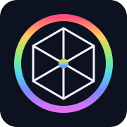
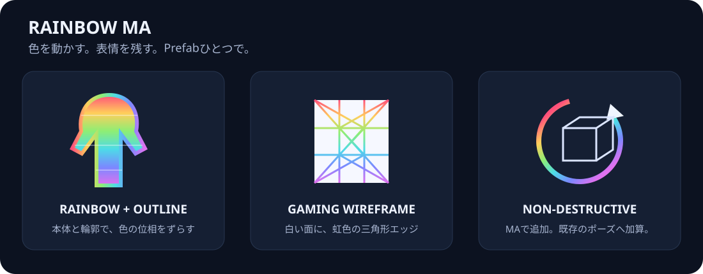
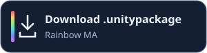
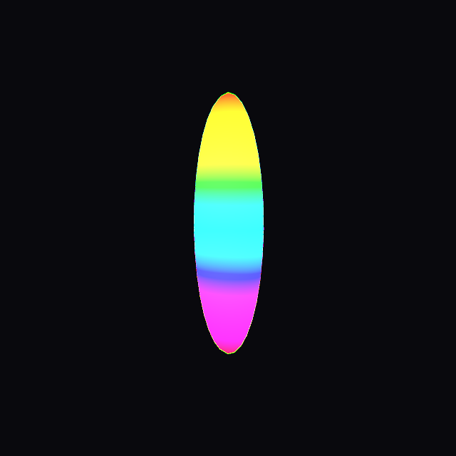
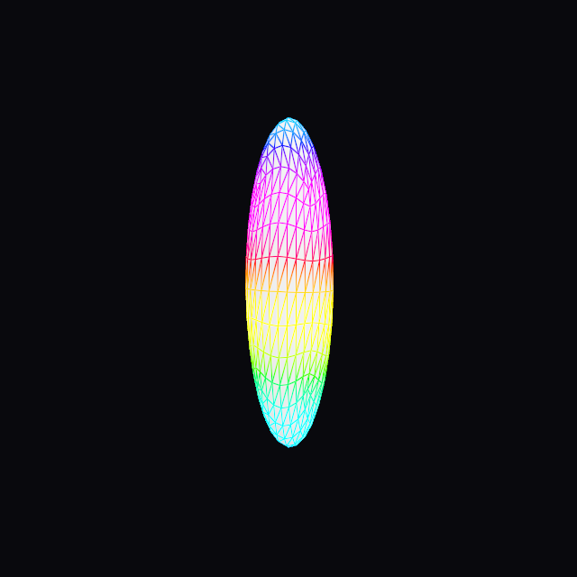
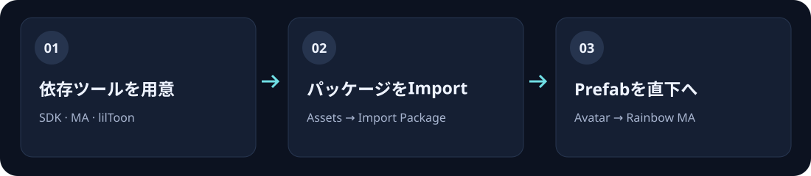
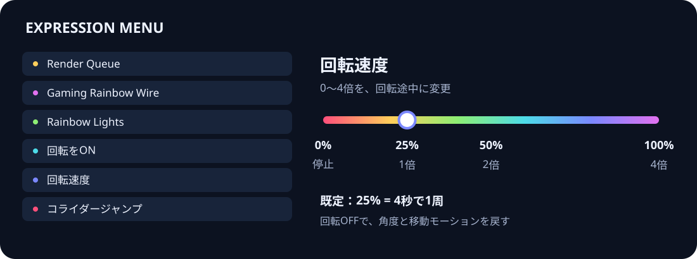

<div align="center">
  
  <h1>Rainbow MA</h1>
  <p><b>いつものアバターを、動き続ける虹色へ。</b></p>
  <p>lilToon × Modular Avatar · Unity 2022.3.22f1 · VRChat PC</p>
  <p>
    <a href="https://github.com/bdunderscore/modular-avatar"></a>
    <a href="https://github.com/lilxyzw/lilToon/releases/tag/2.3.4"></a>
  </p>
  <p>
    <a href="#-ダウンロード">ダウンロード</a> ·
    <a href="#-導入方法">導入方法</a> ·
    <a href="#-メニューと設定">メニューと設定</a> ·
    <a href="#-困ったとき">困ったとき</a>
  </p>
</div>



**Prefabをアバター直下に置くだけ。** 本体・アウトライン・ワイヤーに動く虹色を追加し、回転、ライト、Render QueueをExpression Menuから切り替えられます。MA / NDMFがビルド用コピーに設定を生成するため、元のマテリアルやAnimatorを直接編集する必要はありません。

## ダウンロード

<table>
  <tr><th>lilToonが導入済み</th><th>lilToon未導入</th></tr>
  <tr>
    <td align="center">
      <a href="dist/RainbowMA-Gaming-Speed-ColliderJump.unitypackage?raw=true"></a><br>
      Rainbow MAのみ
    </td>
  </tr>
</table>

両方とも**VRChat Avatars SDKとModular Avatarは別途必要**です。
##  できること

| 機能 | 動作 |
| :-- | :-- |
| 🌈 本体・アウトライン | 高さに沿った虹色が常にスクロール。本体とアウトラインの色の開始位置をずらせます。 |
| 🕸 Gaming Rainbow Wire | 白い不透明な面と陰影を残し、三角形のエッジが虹色に発光します。 |
| 💡 Rainbow Lights | 色が巡る7個のUnity Point LightをON/OFF。 |
| 🔄 回転・速度 | 既存ポーズの描画結果にY軸回転を加算。メニューで0〜4倍に変更できます。 |
| 📚 Render Queue | 全マテリアルをまとめて切り替え。既定プリセットは最大5000。 |
| 🚀 コライダージャンプ | 足元のBox Colliderをローカル限定でON/OFF。読み込み時はOFF。 |
| 🎯 アウトラインの例外 | 特定オブジェクトだけを除外。子階層を含めるかも選べます。 |

<table>
  <tr><th>虹色の本体・アウトライン</th><th>白い面＋虹色のWire</th></tr>
  <tr>
    <td></td>
    <td></td>
  </tr>
</table>

上の画像は検証用メッシュの静止プレビューです。VRChat実機のアバター画像ではありません。色の流れと発光の見え方は、形状・照明・Bloom設定によって変わります。

## 必要なもの

| 項目 | 検証したバージョン / 対象 |
| :-- | :-- |
| Unity | **2022.3.22f1** |
| VRChat Avatars SDK | **3.10.4** |
| Modular Avatar | **1.18.1** |
| NDMF | **1.14.4**（MAの依存） |
| lilToon | **2.3.4** |
| プラットフォーム | **PC / Windows** |

依存ツール：[Modular Avatar](https://modular-avatar.nadena.dev/ja/) · [lilToon 2.3.4](https://github.com/lilxyzw/lilToon/releases/tag/2.3.4) · [VRChat SDK](https://creators.vrchat.com/sdk/)

カスタムシェーダーとGeometry Shaderを使用するため、Quest / Android向けではありません。

## 🛠 導入方法



1. Avatars SDK・MA・lilToonを導入したUnityプロジェクトを開きます。
2. **Assets → Import Package → Custom Package…** からダウンロードした`.unitypackage`を選び、インポートします。
3. `Assets/RainbowMA/Prefabs/Rainbow MA.prefab`を、**Avatar Descriptorが付いているアバターの直下**へドラッグします。
4. Prefabインスタンスの設定を調整し、Play Mode / NDMFビルドで確認してからアップロードします。

```text
My Avatar                  ← Avatar Descriptor
├── Armature
├── Body
├── Clothes
└── Rainbow MA              ← Prefabをここへ
```

アバター1体につきPrefabは1つです。取り外すと、Rainbow MAによるビルド時の追加も外れます。既に旧版を使用している場合は同じ`Assets/RainbowMA`へインポートして更新してください。

## 🎛 メニューと設定



MAのビルド後、既存Expression Menuへ**Rainbow MA**が追加されます。

| メニュー | 使い方 |
| :-- | :-- |
| **Render Queue** | `Original Queue`で元の値。「次へ」で高い値のページへ。 |
| **Gaming Rainbow Wire** | 通常の虹色表示と、白い面＋虹色Wireを切り替え。 |
| **Rainbow Lights** | 周囲を照らす7個のライトをON/OFF。 |
| **回転をON** | 見た目全体をルート原点のY軸で回転。OFFで角度0へ戻します。 |
| **回転速度** | Radial Puppetで速度を変更。既定は25%。 |
| **コライダージャンプ** | ローカルの足元ColliderをON/OFF。 |

### 回転速度

| スライダー | 既定設定での速度 |
| :-- | :-- |
| **0%** | 現在の角度で停止 |
| **25%** | 1倍 · 4秒で1周 |
| **50%** | 2倍 · 2秒で1周 |
| **100%** | 4倍 · 1秒で1周 |

Prefabの`Rotation Seconds`で基準周期、`Rotation Max Speed Multiplier`で最大倍率を調整します。速度変更は回転途中に反映されます。速度は保存されますが、回転ONの状態は保存されません。

回転ON中だけBaseレイヤーの移動・ジャンプ・落下・着地モーションを静止側へ切り替えます。実際の移動操作は可能で、Gesture / Actionの既存コントローラーは維持します。独自のBaseで移動モーションが残る場合は、`Additional Locomotion States`に該当ステート名を完全一致で追加してください。

> [!NOTE]
> 回転はシェーダーによる**見た目の効果**です。Transform・視点・PhysBone・当たり判定は回転しません。RendererのTransform自体を動かす小物では、回転中心がずれる場合があります。

### アウトラインの例外

アバター上の**Rainbow MA Prefabインスタンス**を選び、Inspectorで設定します。

| 設定 | 指定方法 |
| :-- | :-- |
| `Outline Excluded Objects` | 除外するオブジェクトをHierarchyからドラッグ。 |
| `Outline Exclude Children` | ONで子階層も除外。OFFで指定オブジェクト自身のみ。 |

例外はアウトラインだけに適用します。本体の発光、Wire、Queue切り替えは続きます。非アクティブの子も対象で、空欄・アバター外の参照は無視します。

### Render Queue

既定値：`Original / 2000 / 2450 / 3000 / 3100 / 4000 / 4500 / 4700 / 4800 / 4900 / 4999 / 5000`

`Queue Presets`で1〜256個を指定できます。`0`は元のQueueを保持する特別値です。各メニューページは8項目以内に分割されます。

Queue値はアニメーションで直接変更せず、事前生成したマテリアルに切り替えます。任意整数を連続指定するスライダーではありません。[Unityの有効範囲](https://docs.unity3d.com/2022.3/Documentation/ScriptReference/Material-renderQueue.html)に合わせ、上限は5000です。

### 発光とライト

既定の虹色周期は約6.67秒です。`Rainbow Speed`、`Outline Phase Offset`、`Wire Phase Offset`で速さ・色のずれを調整できます。Outlineは本体より約1/3周、Wireは約2/3周ずらしています。

ライトは影なし・範囲1.2m・強度0.4のUnity Point Lightです。`Light Range`と`Light Intensity`で調整できます。Light Volumesを追加する機能ではありません。周囲への照明はワールドの受光設定、光のにじみはBloom設定に依存します。

### コライダージャンプ

[Kaiser氏の記事](https://note.com/kaiservrchat/n/n506e7572c3ef)で紹介されている足元Colliderの方式を参考にしています。

| 項目 | 既定値 |
| :-- | :-- |
| Transform Position | `(0, 10, 0)` |
| Box Collider Center | `(0, -10, 0)` |
| Box Collider Size | `(1, 1, 1)` |
| Is Trigger | OFF |
| 初期状態 / 状態保存 | OFF / 保存しない |
| 有効になる対象 | 自分のローカル表示のみ |

`Jump Collider Position / Center / Size`で体格に合わせて調整できます。

> [!IMPORTANT]
> Colliderの生成・切り替えはUnityで検証済みですが、**現在のVRChat内で実際に上昇する動作は未検証**です。参考記事は2022年の方式で、クライアントやワールドの制限によって動作しない場合があります。

## 🔍 困ったとき

| 症状 | 確認すること |
| :-- | :-- |
| ダブルクリックしてもImport画面が出ない | Unity内の **Assets → Import Package → Custom Package…** から開く。 |
| `Rainbow MA shaders are missing` | lilToon 2.3.4の導入を確認し、`Assets/RainbowMA/Shaders`を右クリックしてReimport。 |
| マテリアルがピンクになる | Consoleのシェーダーエラー、lilToonの二重導入、PC用プラットフォーム設定を確認。 |
| メニューが追加されない | Prefabがアバター直下に1つあり、有効になっているか確認。メニューはMAビルド時に追加されます。 |
| 一部の移動アニメーションが残る | 独自のBaseステート名を`Additional Locomotion States`に指定。 |
| ライトが周囲を照らさない | メニューのLights、強度・範囲、ワールド側のリアルタイムライト受光設定を確認。 |

さらに詳しい設定は[日本語リファレンス](Assets/RainbowMA/README_日本語.txt)を参照してください。

## 🧪 検証状況

別のUnity 2022.3.22f1プロジェクトで、MA / NDMFビルド、Queue / Wire全24組み合わせ、4種類のシェーダー、0 / 90 / 360度のGPU描画、速度パラメータ、ColliderのON/OFF・ローカル条件、元データの保持を確認しています。

**VRChat実機テストは含みません。** 詳細は[検証記録](docs/verification.txt)を参照してください。

## 🗂 リポジトリ構成

```text
Assets/RainbowMA/       Unityへ導入するソース・シェーダー・Prefab
dist/                  Unityがネイティブ出力した配布パッケージ
docs/images/           README用のオリジナルSVGと検証プレビュー
docs/verification.txt  検証記録
```

UnityのLibrary・Temp・ローカルバックアップは含めていません。

## 🙏 使用ツール・参考

- [lilToon](https://github.com/lilxyzw/lilToon) — ベースシェーダー。
- [Modular Avatar](https://modular-avatar.nadena.dev/ja/) / [NDMF](https://ndmf.nadena.dev/) — ビルド時の非破壊処理。
- [VRChat SDK](https://creators.vrchat.com/sdk/) — メニューとアバター設定。
- [コライダージャンプの参考記事](https://note.com/kaiservrchat/n/n506e7572c3ef) — Collider配置の参考。

README用のSVGは本プロジェクト用に作成しています。lilToon同梱版に含まれるlilToonのライセンスは[MITライセンス](docs/licenses/lilToon-MIT.txt)を参照してください。
